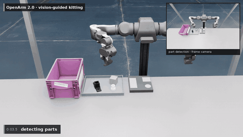
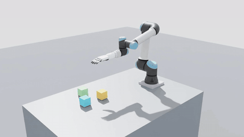
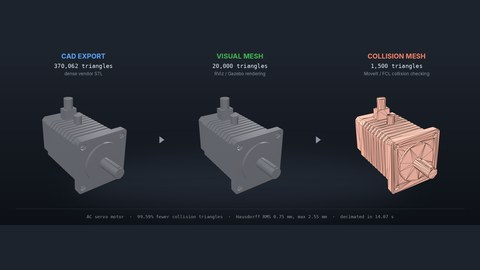
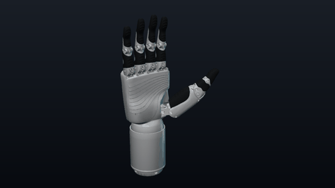
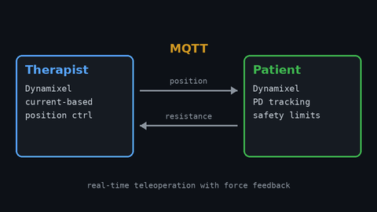
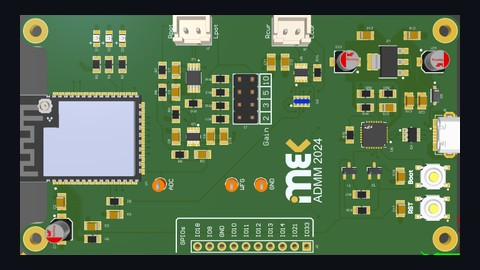
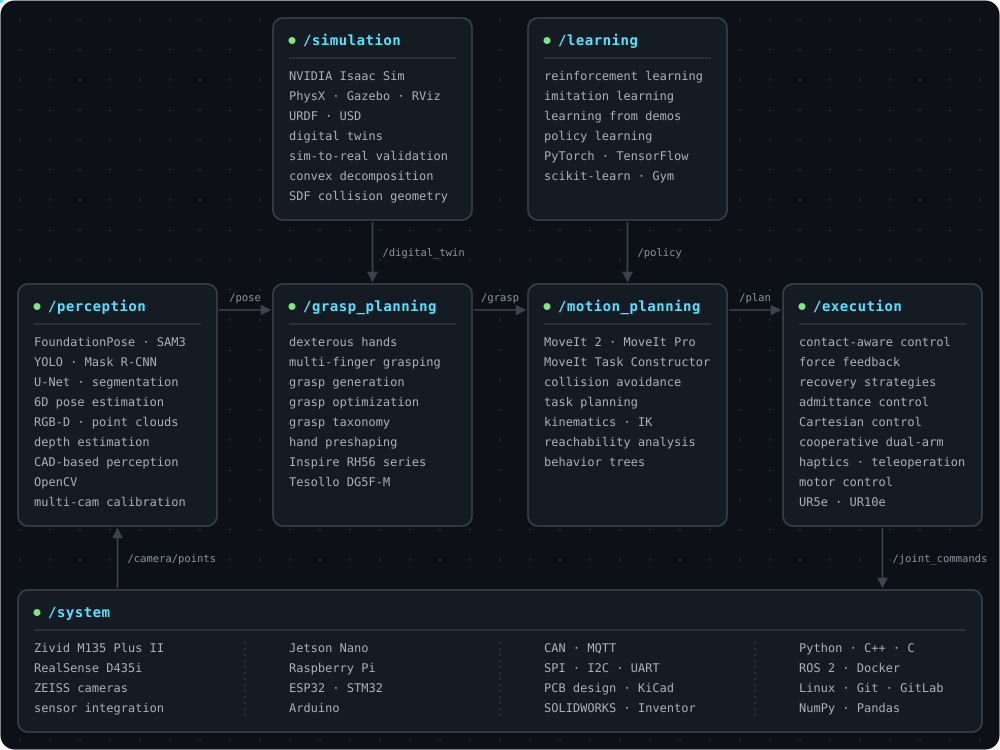

  <picture>
    <source media="(prefers-color-scheme: dark)" srcset="assets/header.svg">
    <source media="(prefers-color-scheme: light)" srcset="assets/header-light.svg">
    
  </picture>

  <b>Robotics engineer building manipulation systems end to end: perception, grasp and motion planning, control, and simulation in NVIDIA Isaac Sim.</b>

  
  
  

### About

I work across the full manipulation stack with ROS 2, MoveIt 2, MoveIt Task Constructor and NVIDIA Isaac Sim. My focus is dexterous manipulation and sim-to-real, and every project reports measured results rather than a demo alone. I am currently working on reinforcement learning for in-hand manipulation with fingertip tactile sensing. Based in Heilbronn, Germany.

### Featured projects

<table>
  <tr>
    <td width="50%" valign="top">
      
      <h4><a href="https://github.com/ookkshirsagar/openarm-vision-kitting">Vision-guided kitting · OpenArm 2.0</a></h4>
      RGB-D part detection, MoveIt Task Constructor pick and place, NVIDIA Isaac Sim. 
      <b>8 / 8 kits · 24 / 24 parts · 4 mm placement error</b> 
      ROS 2 · MoveIt 2 · MTC · Isaac Sim · Python
    </td>
    <td width="50%" valign="top">
      
      <h4><a href="https://github.com/ookkshirsagar/moveit-mtc-pick-and-place">Dexterous pick and place · UR5e + RH56DFX</a></h4>
      End-to-end MTC task with a contact-aware hand closure; stacks cubes squarely, on mock hardware or in Isaac Sim. 
      <b>50 / 50 random picks and places · 5 / 5 three-cube stacks · 1.2 s planning</b> 
      ROS 2 · MoveIt Task Constructor · ros2_control · C++
    </td>
  </tr>
  <tr>
    <td width="50%" valign="top">
      
      <h4><a href="https://github.com/ookkshirsagar/urdf-mesh-optimizer">urdf-mesh-optimizer</a></h4>
      Turns heavy CAD exports into real-time visual and collision meshes for a whole URDF in one command, with Hausdorff error reports and a MoveIt check for CI. 
      <b>370k → 1.5k collision triangles (−99.6 %) · 0.75 mm RMS deviation</b> 
      Python · Open3D · URDF · pip package
    </td>
    <td width="50%" valign="top">
      
      <h4><a href="https://github.com/ookkshirsagar/rh56dfx_description">rh56dfx_description</a></h4>
      ROS 2 description package for the Inspire RH56DFX hand, ready for MoveIt, RViz and ros2_control. 
      <b>Left and right hands · 6 actuators driving mimic-joint fingers</b> 
      ROS 2 · URDF / xacro · ros2_control
    </td>
  </tr>
  <tr>
    <td width="50%" valign="top">
      
      <h4><a href="https://github.com/ookkshirsagar/Wrist_Rehabilitation">Wrist rehabilitation robot</a></h4>
      Teleoperated therapy: the therapist's motion is mirrored to the patient's actuator in real time, with force feedback and safety-limited control. 
      <b>83° / 81° flexion–extension range · limits checked every control cycle</b> 
      Python · Dynamixel · MQTT · control
    </td>
    <td width="50%" valign="top">
      
      <h4><a href="https://github.com/ookkshirsagar/Autonomous-Object-Detection-Robot-using-EIT">Hidden Hunter · buried-object detection</a></h4>
      Ground robot that maps buried objects with electrical impedance tomography, using a custom ESP32-S2 measurement board. 
      <b>Buried objects detected up to 50 mm deep</b> 
      Raspberry Pi · ESP32 · PCB design · MQTT
    </td>
  </tr>
</table>

In progress: <a href="https://github.com/ookkshirsagar/dg5f-tactile-inhand-rl"><b>dg5f-tactile-inhand-rl</b></a>, which asks whether touch helps: in-hand rotation with the Tesollo DG-5F-S in Isaac Lab, PPO with and without fingertip tactile sensing.

### Toolbox

  <picture>
    <source media="(prefers-color-scheme: dark)" srcset="assets/skills.svg">
    <source media="(prefers-color-scheme: light)" srcset="assets/skills-light.svg">
    
  </picture>

  <picture>
    <source media="(prefers-color-scheme: dark)" srcset="assets/footer.svg">
    <source media="(prefers-color-scheme: light)" srcset="assets/footer-light.svg">
    
  </picture>

